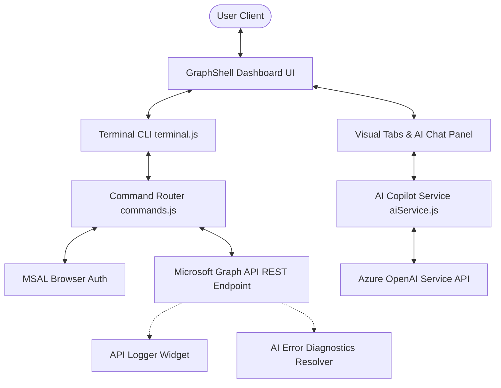
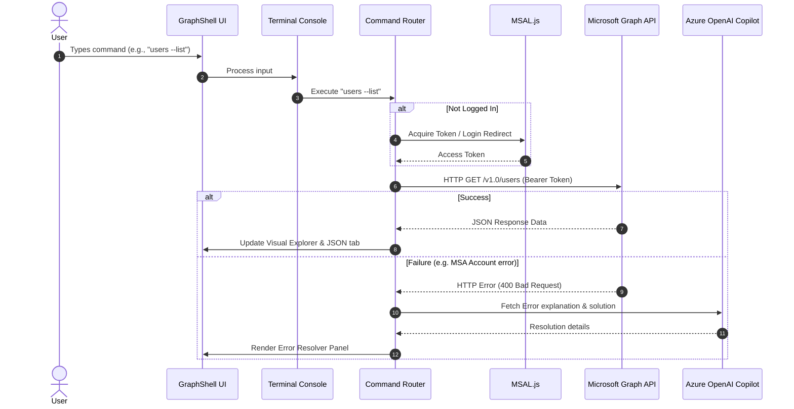

# 💻 GraphShell: MS Graph Terminal Portal & AI Copilot

An interactive, high-fidelity terminal portal and AI Copilot for Microsoft Graph API and Azure AD directory services. GraphShell provides a real-time command-line interface directly in your browser, combined with rich visual widgets, an active API transaction logger, and AI-powered natural language query translation.

---

## 🏛️ Core Architecture

The application is structured as a decoupled, responsive client-side Single Page Application (SPA) driven by standard ES Modules.



---

## 🔄 Sequence Flow Diagram

The sequence below illustrates how user commands are captured, authenticated, resolved against Microsoft Graph, and how the AI Copilot translates prompts:



---

## 📂 Project Directory Structure

Below is the layout of the GraphShell codebase:

```
graph-shell/
├── Footer/
│   ├── Footer.css               # CSS styles for the footer component
│   └── Footer.jsx               # React wrapper of the footer component
├── aiService.js                 # Azure OpenAI interface & natural language translation engine
├── app.js                       # Main application lifecycle, state controller, & UI events
├── azure_openai_setup.md        # CLI script template to deploy Azure OpenAI instances
├── commands.js                  # Microsoft Graph command definitions and request router
├── index.css                    # Main application stylesheet (CRT scanlines, glassmorphism, responsive grid)
├── index.html                   # HTML5 page layout and layout panels
├── logo.png                     # Glowing tech dashboard logo & favicon source
├── manifest.json                # PWA progressive web app configuration
├── sw.js                        # Service worker caching engine
└── terminal.js                  # Terminal input line controller and boot emulator
```

---

## 🛠️ Technology Stack & Versions

GraphShell is optimized for speed, security, and visuals by running fully client-side:

| Technology | Layer | Version / Source | Description |
| :--- | :--- | :--- | :--- |
|  | Core Markup | Living Standard | Semantic document outline with a responsive dual-pane flex layout. |
|  | Styling System | CSS3 / Custom Variables | Custom CRT scanner styling, glassmorphism overlays, and dark-mode gradients. |
|  | Logic / Controller | ES6+ Modules | Event handling, state management, and async fetch operations. |
| | Authentication | `v2.35.0` (CDN) | Microsoft Authentication Library for secure Entra ID OAuth sign-ins. |
| | AI Engine | `gpt-4.1-mini` (2025-04-14) | Cognitive model deployment for natural language CLI routing. |
| | Typography | `Inter` & `Fira Code` | Modern UI typography and fixed-width command typography. |

---

## License

This project is licensed under the **MIT License** — see the [LICENSE](LICENSE) file for details.

---

## Author

### 👤 Francis Ponnu Cruz I
> **Azure Cloud & DevOps Engineer | Microsoft Certified Trainer (MCT)**

#### 🌐 Connect with Me:
[](https://github.com/ajf013)
[](https://www.linkedin.com/in/ajf013-francis-cruz/)
[](https://x.com/Itsme_Ajf013)
[](https://fcruz.org)
[](https://linktr.ee/AJF013)
